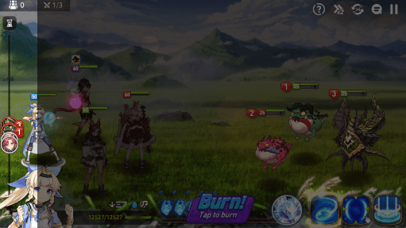
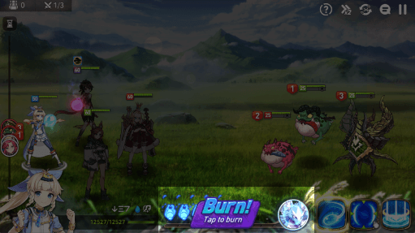
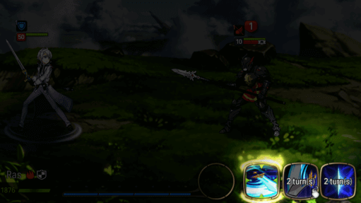

# Epic Seven 战斗研究与画面对照

核对日期：2026-11-12。本文是一次性原作研究和当前场景制作的参考边界，不是国际服持续追踪，也不是“完整战斗已还原”的验收报告。

## 阅读方法与证据等级

- **已确认**：本次实际读到的官方说明、目检的官方客户端教程图，或本地文件结构事实；只确认注明的范围。
- **有线索，未解读**：本地表名、函数名、UI节点等证明相关内容存在，不能证明已取得算法、数值、执行顺序或协议。
- **待验证**：需要指定原作版本实际操作、录屏、可重放输入输出、解码后的数据或独立规则用例。不能用常见攻略中的数字直接填成权威规则。

本地素材基线为 `D:/sevenepic/解包记录.json` 记录的 `pack-15-r4262`，官方清单地址为 [manifest.ssra](https://epic-down.game.playstove.com/Live/world_kor/pack-15-r4262/main/manifest.ssra)。本次读取该记录，不重新下载分包。网页是本次可访问内容，不能推定与这份素材包处于同一客户端版本。

## 官方来源与访问结果

1. [Smilegate 官方 Steam 产品页](https://store.steampowered.com/app/5019180/Epic_Seven/)：确认回合制、属性与技能组合、效果命中/效果抗性、技能演出、World Arena 实时PVP及BP的产品定位。它不提供伤害公式或完整BP时序。
2. [Smilegate 官方 Google Play 产品页](https://play.google.com/store/apps/details?id=com.stove.epic7.google)：确认迷宫、竞技场、公会战、世界首领、实时世界竞技场等不同模式。页面描述公会战为3v3，世界首领使用至多16名英雄；不能把这两种模式直接套成常规4人战斗。
3. [官方 Strategy Guide](https://epic7.onstove.com/en/guide/home)，及 [Hunt](https://epic7.onstove.com/en/guide/hunt)、[Abyss](https://epic7.onstove.com/en/guide/abyss)、[Expedition](https://epic7.onstove.com/en/guide/expedition)、[Rift](https://epic7.onstove.com/en/guide/rift)：网页依赖动态显示。普通网页抽取仅返回外壳；本次通过只读HTTP读取服务器返回的 `__NUXT_DATA__` JSON，确认模式词条与英文远征首领提示，未执行网页脚本、未登录。
4. [官方品牌页](https://epic7.onstove.com/en/brand) 指向 [EpicSeven 官方视频频道](https://www.youtube.com/channel/UCa1C3tWzsn4FFRR7t3LqU5w) 及 [角色介绍播放列表](https://youtube.com/playlist?list=PL-7GrDKcrUlN4r-4la_v4GbA9Znan-HQe)。本次未完整播放视频，未核实任何视频时间戳，因此没有伪造“已逐帧对照”的视频证据。
5. 本地官方客户端教程图片、`verify_info.txt`、`bin/game32_bin.txt`、分表索引和手柄路径映射：见下文。图片的来源链由解包记录和文件清单说明；本次重新比对了纳入仓库的三张图片的字节数和SHA256。

STOVE社区公告页面在本次普通网页访问中只给出JavaScript外壳；尝试公开文章读取接口得到404。本次不把未取得正文的公告算成规则证据，也不依赖社区转载来批准数值规则。

## 截图对照索引

### R01：PVE完整HUD与左侧行动条

- 原始文件：`D:/sevenepic/原始资源/tutorial/help_contents_6_1_image.png`。
- 仓库副本：`docs/reference/battle/help_contents_6_1_image.png`；65,516字节；511×287像素。
- SHA256：`0284dc184f9b9c493aa986853a15d4e9a8f4873850e6e9ddf91bce152ee77498`。
- 清单位置：`D:/sevenepic/文件清单.tsv` 第87154行，来源 `installed:cat_tutorial_b00_0.ssrc`。
- 已目检：我方在左、敌方在右；左缘竖直行动条和角色头像；左上 `1/3` 波次；单位头顶等级、HP和状态；左下当前角色头像和HP；右下技能区；顶部右侧帮助、倍率、自动/菜单/暂停图标区域。
- 教程遮罩突出左侧行动条。图中的按钮只能证明位置与外观，不能证明本项目已支持这些按钮的业务行为。

### R02：魂、燃魂和守护者区域

- 原始文件：`D:/sevenepic/原始资源/tutorial/help_contents_7_1_image.png`。
- 仓库副本：`docs/reference/battle/help_contents_7_1_image.png`；66,382字节；511×287像素。
- SHA256：`5bd6ceafc47425c6c1a1385750bd5b47458f9c752619e6e11bb89ce667596be2`。
- 清单位置：第87155行，来源 `installed:cat_tutorial_b00_0.ssrc`。
- 已目检：底部中间的魂显示、`Burn! / Tap to burn` 控件及右侧圆形入口；三个技能仍位于右下。教程画面与R01来自同一场景，强调区域不同。
- 可用于分组和位置对照；不能从截图计算魂获得量、燃魂消耗、守护者限制、是否消耗行动或跨波次继承规则。

### R03：三技能与冷却表达

- 原始文件：`D:/sevenepic/原始资源/tutorial/help_contents_8_1_image.png`。
- 仓库副本：`docs/reference/battle/help_contents_8_1_image.png`；37,461字节；511×287像素。
- SHA256：`f194ccfda92b534fb507d19c1be65491e4429d5495ad2bcf6fd697170eab48a1`。
- 清单位置：第87156行，来源 `installed:cat_tutorial_b02_0.ssrc`。
- 已目检：右下三技能，首技能发亮，后两项带 `2 turn(s)` 字样；左下当前角色身份和HP，底部横条。可对照可用/冷却状态表达。
- 不能据此把每个角色强制定义为三个可主动点击的技能；被动、变身、技能替换及特殊按钮需单独确认。

这三张副本保留原文件名、原字节与原像素，未缩放、裁切、补字或去遮罩。部分文字为原图内的非正常可读字形；不从这些字形推断中文文案。511×287教程图是布局与控件归属参考，不是1920×1080像素级视觉母版。图片属于原作，本仓库仅纳入这三张明确选定的开发参考，不批量引入解包目录。

### R04—R08：BP与其他本地只读原图

以下仅索引来源，不复制进仓库。本次已目检R04—R08：

- R04，选人：`D:/sevenepic/原始资源/tutorial/help_inforta_3_1_image.png`。左侧蓝队五槽、中右红队五槽、最右可选英雄列表；中央角色大图，顶部倒计时。双方第三槽可见盾状标志。图像证明选人界面和保护标识存在，不证明所有赛季适用规则一致。
- R05，禁人：`D:/sevenepic/原始资源/tutorial/help_inforta_4_1_image.png`。选人结果保留，中央禁用标识、红方禁选按钮与倒计时。与选人是不同交互阶段。
- R06，站位：`D:/sevenepic/原始资源/tutorial/help_inforta_5_1_image.png`。双方各一项显示BANNED，中央四名角色站在位置圈上。证明五选后禁用、四人站位的画面结果；不证明精确选人顺序或超时策略。
- R07，预禁候选：`D:/sevenepic/原始资源/tutorial/help_inforta_7_1_image.png`。英雄网格、两个已选位置、`2/2`、倒计时及确认。只适用于此图记录的配置；不能将两个预禁写死到所有段位、赛季和房间。
- R08，属性关系：`D:/sevenepic/原始资源/tutorial/help_contents_1_1_image.png`。火/自然/冰三角及光/暗双向关系，可确认属性关系需要独立显示；具体命中/伤害修正值待验证。
- 可继续查阅但本次未逐图验收：同目录 `help_infohunt_*`、`help_infoabys_*`、`help_infotrial_renew_*`、`help_infowboss_*`、`clanwar_formation_01.png`、`draft_001_*.png`、`tuto_chaos_arena_*.png`。存在文件不能代替研究其内容。

### R09：官方在线图片与视频入口

以下链接来自发行商公开页面/API；本次已取得地址，但未将远端图片内容作为布局验收依据：

- [Steam官方截图0](https://shared.akamai.steamstatic.com/store_item_assets/steam/apps/5019180/e49eedee571da261c063fe002a14b753c5e3ef0c/ss_e49eedee571da261c063fe002a14b753c5e3ef0c.1920x1080.jpg?t=1793256460)。
- [Steam官方截图1](https://shared.akamai.steamstatic.com/store_item_assets/steam/apps/5019180/5a0706801756b9841f84fac9d0428bbf4a11e69c/ss_5a0706801756b9841f84fac9d0428bbf4a11e69c.1920x1080.jpg?t=1793256460)。
- [Steam官方截图2](https://shared.akamai.steamstatic.com/store_item_assets/steam/apps/5019180/d8e78e6f1164ae15741151912ce28367934ad9c7/ss_d8e78e6f1164ae15741151912ce28367934ad9c7.1920x1080.jpg?t=1793256460)。
- 地址读取依据：[Steam公开产品资料](https://store.steampowered.com/api/appdetails?appids=5019180&l=english) 中 `screenshots`，发行商为Smilegate。营销截图可能合成或省略HUD，不能自动作为实机帧。
- [官方角色视频播放列表](https://youtube.com/playlist?list=PL-7GrDKcrUlN4r-4la_v4GbA9Znan-HQe) 可供后续逐技能对照。本次没有已验证的片段时间戳；正式验收应补“视频标题、角色/技能、开始与结束秒数、对应版本、差异”，不能仅贴频道地址就声称演出一致。

## 全模块研究清单

这里的模块划分是AstralOath的研究与实现边界，不声称是原作源代码架构。应把共享战斗规则、模式规则、命令交互、表现和联网分开验证。

### 1. 战前配置与模式准入

- 需要覆盖：关卡/模式、队伍、站位、英雄/怪物ID、等级/觉醒、技能等级、装备与套装、神器、专属装备、刻印/队伍加成、皮肤和独立语音选择。固定开战配置版本，避免战斗中热更数值。
- 本地证据：`db/character.db`、`skill.db`、`skillset.db`、`cs.db` 是可读分表索引；`character_player.db`、`skill_player.db`、`skillset_player.db`、`equip_stat.db`、`skill_equip.db` 等存在。
- 待验证：记录字段、角色→技能→演出资源ID关系、最终属性合成顺序、各模式禁用/借用英雄和装备规则。名称存在不等于已解析数据。

### 2. 回合、速度与行动条（CR）

- 已确认：R01显示左侧行动条；本地 `game32_bin.txt` 有 `doStartTurn`、`doNextTurn`、`doEndTurn`、`getTurnOwner`、`addNextTurnOwner` 等函数名；官方远征说明明确区分CR增加、速度变化、回合开始/结束的效果。
- 研究用状态应能表达：当前行动者、候选队列/CR、额外回合、无法行动、推条/退条、行动中触发的插入攻击、死亡移出与复活重新进入。这里只列必要状态，不规定原作具体处理顺序。
- 待验证：开场CR随机范围、达到行动阈值与溢出比较、同速/同CR裁决、回合结束重置、额外回合优先级、固定随机种子、速度动态变化后的排序。未经验证不能把常见攻略的百分比常量写入权威逻辑。

### 3. 技能选择、目标与用户命令

- 已确认：R03显示三个技能位置与冷却；官方产品页确认技能时机和组合是战斗操作内容。R01/R02显示敌方目标标记与手动技能区域。
- 需要覆盖：选择技能、查看说明、选定合法目标、取消/切换、确认或即时施放、单体/群体/随机/自身/友方/死亡单位目标、被动不可点、冷却或资源不足、沉默/挑衅等约束。
- 待验证：点按/长按的实际行为，切换目标时是否保留燃魂选择，自动战斗的选技与选人，技能替换和特殊角色按钮，非法命令反馈。不能靠静态截图确认手势与命令提交时点。

### 4. 命中、伤害、治疗与防护

- 已确认：官方产品页提及属性关系、效果命中与抗性；本地 `getSkillAttRate`、`getSkillPow`、`getSkillDefPenRate`、`dealDamage` 等函数名，以及 `skill_immune.db`、`skill_resist.db` 等表存在。
- 必须分别研究：命中/闪避、普通/暴击/强击、属性修正、防御穿透、攻击/生命/防御等缩放、固定伤害、附加伤害、分摊/转移、减伤、护盾、治疗、吸血、伤势/最大生命变化、死亡前保护。不能把所有视觉伤害数字都当成同一种命中事件。
- 待验证：公式、取整、上下限、最小伤害、效果概率与抗性检查关系、忽视抗性例外、护盾/分摊结算顺序、多段攻击与一次技能的区别。本项目目前没有原作公式通过证据。

### 5. 状态、被动与事件优先级

- 需要覆盖：增益/减益/特殊状态、可驱散与不可驱散、持续回合、叠层、免疫、净化/驱散/偷取/转移、状态阻止与延长、沉默/封印/控制、隐身/挑衅类目标限制、死亡/复活/灭亡、技能开始/攻击前后/命中/受击/回合边界的被动事件。
- 本地 `condition_state.db`、`cs_player.db`、`skillact.db`、`applyPassive`、`appendCounterAttack`、`checkCoopAttack` 只提供模块线索，未读出执行体。R08及 `help_contents_2_*` 的图标只能帮助识别状态显示分类。
- 官方远征提示提供实际反例：Gigantes的特定状态在回合结束造成全队伤害、可由非攻击技能移除；Symaqus的疲劳在回合开始解除；Pherus的一种姿态与受到六次攻击有关。故“统一在每次技能后扣一回合”不足以概括原作。来源：官方Strategy Guide返回的英文首领提示；这些是摘要，精确规则仍须核对首领技能说明。
- 待验证：反击、协攻、追加攻击、额外回合之间的区分与递归限制；一次技能多目标的遍历顺序；多被动同时触发和死亡检查时机。

### 6. 战斗资源与模式资源

- 已确认：R01—R03包含HP、魂/燃魂、技能冷却和圆形守护者入口。资源应分清队伍共享、角色独有、模式专属三种归属。
- 研究范围：HP/护盾/最大HP，魂与燃魂，专注/斗志等角色资源，技能冷却、技能次数，守护者；另有PVE入场消耗、迷宫士气、模式积分等战斗外/模式资源。
- 待验证：角色资源清单及上限、获得/消耗时点、死亡/复活/换波后的保留，燃魂和守护者的模式许可，技能消耗失败回滚。不能把资源按钮显示误报为经济或奖励闭环已接通。

### 7. 胜负、关卡推进与PVE差异

- 普通关卡需要波次、增援、转场、首领阶段、特殊目标、胜负和结果页。R01的 `1/3` 是已确认的一个三波画面，不代表所有PVE固定三波；敌方清空后可能进入下一波，也可能结束。
- 冒险/支线：额外研究剧情节点、路线/遭遇、NPC支援、关卡星级目标和剧情插入。波次之间的HP、状态、魂、冷却继承必须逐模式验证。
- 讨伐/精灵祭坛：固定敌方配置与首领机制、自动/重复与结果统计；讨伐存在官方独立攻略与本地 `help_infohunt_*` 证据。
- 深渊/挑战深渊：楼层和特定挑战目标；本地教程及官方指南区分普通与挑战统计。不能只复用普通通关结果。
- 迷宫/团本：除战斗外还有探索和队伍资源；不能用一张战斗HUD代表完整迷宫。
- 自动塔、试炼、远征、裂隙、世界首领、古代遗产等：分别研究装置/局内成长、计分/阶段、贡献与特殊首领机制、多次挑战状态、批量编队、专用支援。模式名存在或官方提及，不能证明全部细节已研究完毕。
- 待验证：全灭后复活机会、逃跑、平局、超时、特殊强制失败、活动例外、评分和奖励。胜负事件与奖励发放由服务端确定，表现完成不是结算触发器。

### 8. PVP、World Arena与BP

- 区分普通竞技场、实时世界竞技场、公会战、模拟房间/观战、Draft Arena及特殊规则模式。官方产品页确认实时PVP和3v3公会战；本地有 `pvp_rta_*`、`pvp_npcbattle_*`、`pvp_rta_draft_*` 等独立表。
- BP需要分阶段记录：匹配/房间准入→模式规则提示→预禁→双方选人→最终禁人→站位→加载/开战。R04—R07证明其中多种独立画面，不足以证明整条状态机和阶段顺序在所有配置中一致。
- 预禁候选、禁止重复、可选英雄范围、租借/支援英雄、选人先后手、每轮选择数量、保护槽位、最终人数、计时、超时默认选择、确认、主动退出、断线/重连/重赛均为独立验证项。
- 精确 `1-2-2-2-2-1` 选人序列、预禁数量、第三位保护的赛季/段位适用范围，本次尚未取得可执行配置和完整官方动态证据，保留待验证，不写死为全模式规则。
- 战斗中还需单独核对Frenzy/惩罚等计时或回合修正、RTA出手计时、投降、表情、连接状态、双方隐私/技能可见信息。`gamepad_path_map/battle.json` 的 `n_inbattle_frenzy_tooltip`、`pvp_rta_penalty.db` 等是存在性线索，不是具体参数。
- `客户端附加资源/独立更新/tflite/banpick` 与 `battle` 的模型文件不能替代BP规则或战斗结算；本次不运行模型，也不把助手建议当权威决策。

### 9. 演出、声音与HUD状态

- 战斗领域先产生事件，表现层消费角色动作、移动、打击点、技能特效、镜头、暗屏、震屏、Cut-in、伤害/治疗浮字、状态图标、死亡/复活和音效/日语语音。同步与加速不应反过来改变规则结果。
- 共用HUD区域按R01—R03搭建，但模式差异要显式处理：PVE波次/首领目标/自动与重复，RTA双方身份/计时/保护/惩罚提示，公会战轮次，试炼/远征的分数或专用目标。不能让所有模式一直显示同一组按钮。
- 动态交互待验证：角色详情与行动顺序弹层、效果说明、选技/选目标高亮、自动切换、加速、暂停、放弃确认、加载、断线重连和结果页。静态布局通过不等于这些状态通过。
- 已有CharacterLab仅支持三个样本角色的受限演出预览；未知条件、镜头/粒子语义、音画资格等限制以[CharacterLab README](../../Assets/Game/Modules/CharacterLab/README.md)与[CharacterPresentation README](../../Assets/Game/Modules/CharacterPresentation/README.md)为准。

## 本地规则证据的硬边界

之前只读审查得到的事实在本次相关文件存在性核对中没有被新的解码证据替代：

- `db`内1,040个`.db`中14个为明文YUNADBSET索引；其余1,026个尚无可验证的数据读取方式。角色21、技能22、技能集20、状态集合21个索引分表存在，不表示字段和记录已读出。
- `verify_info.txt`是21个Lua文件名及哈希，其中有 `formula.lua`、`skill_proc.lua`、`battle_logic*.lua`；不是源码。
- `bin/game32_bin.txt`、`bin64/game64_bin.txt`各为511个BattleLogic函数与553个UNIT函数的名称/哈希清单；`game.bin`不是已取得的可读规则实现。不能因为存在这些文件便宣称公式、触发顺序、BP全部可恢复。
- `db/level_stage_2_data.db`指向的6个同名前缀分表在此前全目录检索中没有找到；它们是否弃用、运行时生成或确有缺失，尚未解释。不能直接称作漏包，也不能忽略它们后承诺完整性。
- 数值、公式、目标选择、概率与随机源、事件优先级、跨波次状态、赛季/模式差异需要独立规则证据与服务端同源测试。[战斗验收清单](../delivery/battle-acceptance.md)仍是后续准入要求。

## 当前子任务边界与验收

本轮场景包含：**Forest2/Forest3手工重组背景，拉斯/梅赛德丝/安洁莉卡三个英雄与两个史莱姆的独立样例**；HUD左上波次位置参考R01，CR/魂/三技能区参考R01—R03。背景组合、五个单位组合和示例数据不是已核实的原作关卡配置。

当前允许据此检查的行为：

1. 独立场景能打开，五个单位有明确站位，背景层次/地面接触和遮挡可检查。
2. HUD分组、左右布局和波次位置能逐图对照；角色和敌方不会被固定面板长期遮住。
3. 原图参考可从本文件直接打开；三张副本与原始SHA256一致。
4. 模式不支持、交互未实现或使用示例数值时明示；按钮占位不能记作选技、CR、燃魂、暂停或结算已经通过。

本轮不据此批准完整战斗：不包含原作伤害公式、全部角色/技能、BP、在线对战、PVE全部模式/波次、经济奖励、服务器压测或移动端真机一致性。测试场景、编译、接口、占位按钮、三角色演出和原图存在性都不能替代真实玩法还原。

后续每完成一个机制应记录：固定原作版本/模式、证据截图或视频时间戳、源表/资源ID、输入与随机种子、预期事件顺序、实际输出、差异、用户结论。先验证可观察行为，再扩大角色和模式覆盖。

## 本次检查记账

- 实际完成：现行AGENTS/入口/状态/规范及相关模块README阅读；官方公开产品页/攻略数据一次性读取；R01—R08本地原图目检；三张副本字节和SHA256比对；相关规则文件存在性核对。
- 未执行：任何未知资源代码、game.bin、模型推理、Unity/Player、战斗规则测试、原作实机操作或视频逐帧验收。
- 环境限制：网页抽取不执行动态站点，STOVE公开文章接口尝试返回404。最终结论只依赖实际读到的内容。
- 文件所有权：本研究子任务仅写本文及 `docs/reference/battle/help_contents_{6,7,8}_1_image.png`。文档入口、当前状态、变更日志及Git操作由协调者统一处理。